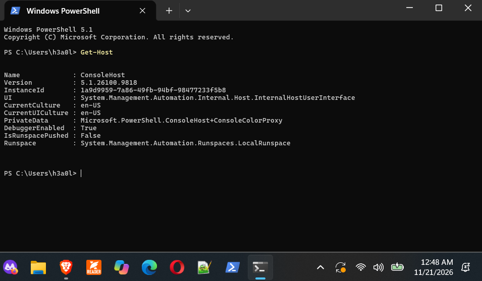
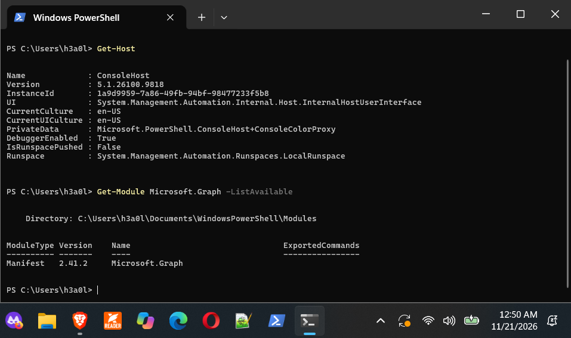
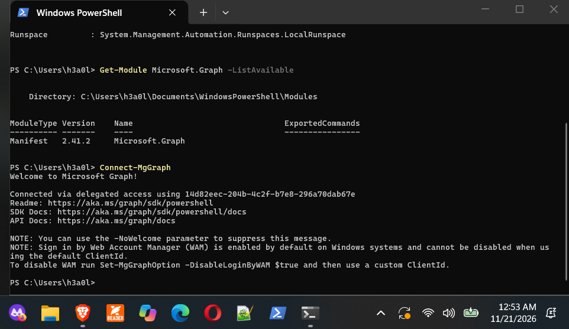
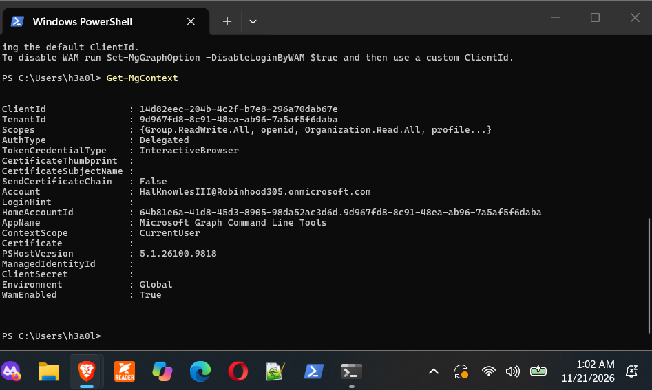
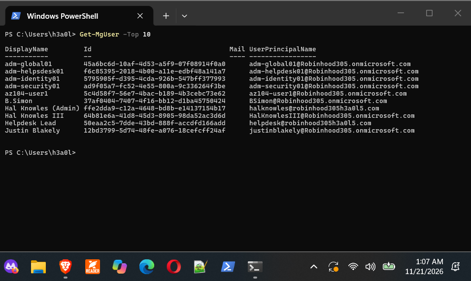

# 🛡️ PROJECT 2
# 🔐 Robinhood305 Identity Automation Platform 
---

# 🔌 PHASE 01 - Microsoft Graph Connectivity

## 🎯 Objective
Establish secure connectivity between Microsoft Graph PowerShell and the Robinhood305 Microsoft Entra ID tenant to support future identity lifecycle automation and governance activities.

## 🏢 Business Scenario
Robinhood305 Financial Services currently supports approximately 50 employees and is preparing to scale operations to more than 500 employees over the next several years.

As the organization grows, traditional manual identity administration becomes increasingly difficult to maintain. Administrative tasks such as:
- 👤 User creation
- 👥 Group membership assignments
- 🔑 Access provisioning
- 🚪 Offboarding
- 📊 Reporting

must eventually be automated. Before automation can occur, a secure connection to Microsoft Graph must be established. Microsoft Graph serves as the automation interface that allows PowerShell scripts to interact with Microsoft Entra ID programmatically.

## 💡 Analogy
Imagine a school with hundreds of students. An administrator could walk classroom to classroom manually updating records. However, it is much faster to connect directly to the school's central database and make changes from a control console.

Microsoft Graph serves as that control console. Instead of manually clicking through the Microsoft Entra portal, administrators can interact with identities through code.

## ✅ Solution Implemented
A Microsoft Graph PowerShell connection was established between the administrator workstation and the Robinhood305 Microsoft Entra ID tenant. The following activities were performed:
- 💻 Verified PowerShell environment
- 🔍 Confirmed Microsoft Graph module availability
- 📦 Installed Microsoft Graph module
- 🔐 Authenticated to Microsoft Entra ID
- 🛡️ Validated Microsoft Graph session context
- 📋 Queried existing Robinhood305 identities

## 🛠️ Technical Implementation

### Step 1: Verified PowerShell Environment
- **Command:** `Get-Host`
- **Purpose:** Confirm the PowerShell environment was operational and capable of running Microsoft Graph modules.

### Step 2: Validate Microsoft Graph Module
- **Command:** `Get-Module Microsoft.Graph -ListAvailable`
- **Purpose:** Determine whether Microsoft Graph PowerShell SDK was already installed.

### Step 3: Install Microsoft Graph PowerShell SDK
- **Command:** `Install-Module Microsoft.Graph -Scope CurrentUser`
- **Purpose:** Install the PowerShell SDK required to communicate with Microsoft Graph.

### Step 4: Connect To Microsoft Graph
- **Command:** `Connect-MgGraph`
- **Purpose:** Authenticate against the Robinhood305 Microsoft Entra ID tenant.

### Step 5: Validate Session Context
- **Command:** `Get-MgContext`
- **Purpose:** Verify:
  - 🏢 Tenant Connection
  - 👤 Authenticated Account
  - 🎟️ Graph Scopes
  - ⚡ Active Session

### Step 6: Enumerate Identities
- **Command:** `Get-MgUser -Top 10`
- **Purpose:** Retrieve user objects directly from Microsoft Entra ID through Microsoft Graph. This validated successful API communication between PowerShell and Microsoft Entra ID.

## 📸 Evidence

### 💻 PowerShell Environment
**Evidence File:** `A.1-PowerShell-Environment.png`

*Figure 1. PowerShell environment verification.*

### 📦 Microsoft Graph Installation
**Evidence File:** `A.2-Graph-Installation.png`

*Figure 2. Microsoft Graph PowerShell SDK successfully installed.*

### 🔐 Microsoft Graph Authentication
**Evidence File:** `A.3-Graph-Authentication.png`

*Figure 3. Successful authentication into the Robinhood305 Microsoft Entra ID tenant.*

### 🛡️ Graph Session Context
**Evidence File:** `A.4-Graph-Context.png`

*Figure 4. Microsoft Graph session validation showing tenant and account information.*

### 📋 User Enumeration
**Evidence File:** `A.5-User-Enumeration.png`

*Figure 5. PowerShell query successfully retrieving identities from Microsoft Entra ID.*

## ✔️ Validation Performed
Verified:
- ✅ PowerShell operational
- ✅ Microsoft Graph SDK installed
- ✅ Authentication successful
- ✅ Tenant connection confirmed
- ✅ Graph context validated
- ✅ User enumeration successful
- ✅ API communication functioning

## 🛡️ Security Benefits
The implementation provides:
- 🔒 Secure API-based administration
- 🖱️ Reduced dependency on manual portal administration
- 🔁 Repeatable automation capability
- 📈 Scalable identity management
- ⚡ Improved administrative efficiency
- 🏗️ Foundation for identity lifecycle automation

## 🧠 Lessons Learned
Microsoft Graph provides a secure and scalable mechanism for interacting with Microsoft Entra ID programmatically. Establishing authenticated Graph connectivity is the foundational requirement for identity governance automation, lifecycle workflows, reporting, provisioning, and offboarding activities. This phase serves as the entry point for all future Identity Automation Platform development.

---
### 🧭 Phase Navigation
[🔝 Back to Top](#top) | [Next: Phase 02 ➡️](#phase-2) | [🛠️ IAM Automation Platform](#top)
## 🎓 Explain Like I'm 13
Imagine Microsoft Entra ID is a giant school. Normally, an administrator would walk to every classroom and update records manually. Microsoft Graph is like getting access to the school's master computer. Instead of walking around the building, you can type commands and the computer performs the work for you.

## 💼 Business Value
Robinhood305 Financial Services is planning for growth from 50 to 500 employees. By establishing Microsoft Graph connectivity, the organization created the foundation for:
- 🚀 Automated onboarding
- 👋 Automated offboarding
- 🛡️ Access governance automation
- 📄 Compliance reporting
- 🔄 Identity lifecycle management

without requiring additional manual administrative effort.

## ⏭️ Next Phase
➡️ **Phase 02 - [Bulk User Provisioning**](#phase-2)

**🎯 Goal:** Automate the creation of multiple employee accounts using CSV-driven onboarding and Microsoft Graph.
